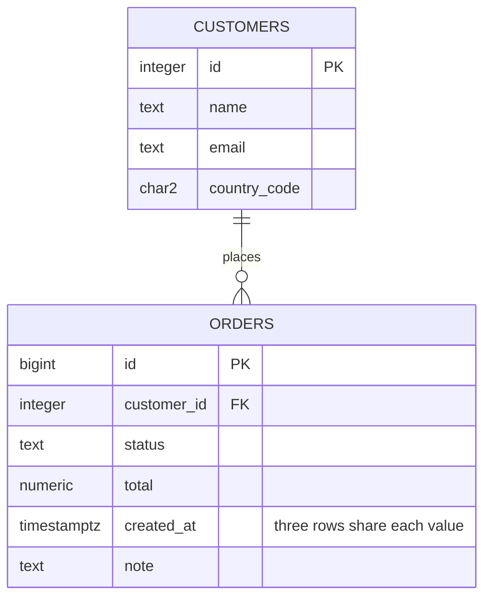
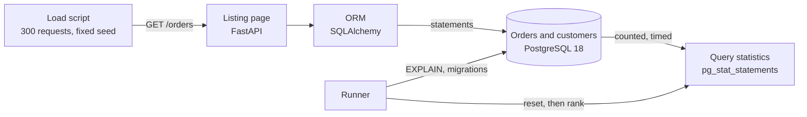

# Architecture: busy listing

A load script drives a listing page; the page's ORM talks to PostgreSQL; PostgreSQL's own statistics rank what ran. Component names follow the lesson's diagram ("The project: rank the queries, then fix the top two").

## Pattern: ports and adapters in four layers

The Python package `busy_listing` is a hexagon around the listing. `domain/` holds what the lesson talks about as pure values (the opaque `Cursor`, `ListingRequest` and its validation, `Strategy`, a ranked `StatementStat` and the rule that rows with the same text are added together, the page sequence of the load) and imports no framework. `application/` has two use cases, `ListOrders` (one page, by the strategy asked for) and `ReplayLesson` (the same load four times, ranking the database's statements each time), over ports: `OrderRepository`, `StatementStatistics`, `IndexLayout`, `PlanCapture`, `LoadDriver`, `ArtifactStore`. `infrastructure/` implements them with SQLAlchemy, `pg_stat_statements`, HTTP and files. `interfaces/` are the FastAPI application and the commands, and the composition root (`interfaces/common.py`). The dependency rule is the layer order; import-linter fails the build on a violation, and a second contract keeps `psycopg`, SQLAlchemy, FastAPI, `requests` and `uvicorn` out of `domain` and `application`.

Why it fits: this system has two boundaries that change independently, the HTTP edge and the database edge (an ORM, and a statistics view), and the lesson's whole point is a *difference* between implementations behind one contract: three ways to answer the same request, ranked by the database. A port with three methods makes that difference visible and testable; an adapter is where the N+1 lives, not the use case. Decision record: [docs/adr/0001](docs/adr/0001-n-plus-one-lives-in-the-adapter.md).

## Components

Component names follow the lesson's diagram ("The project: rank the queries, then fix the top two").

| Component | What it is | What it owns |
|---|---|---|
| **Load script** | `infrastructure/http_load.py` (`HttpLoadDriver`), `interfaces/load_cli.py` | The page sequence: 300 requests, pages 0, 1, 2, 50, 100, 5,000 and 10,000 chosen with a fixed seed. For keyset paging it first looks up a bookmark (cursor) for each page, outside the timed run. Timeouts and retries on the HTTP calls; reports the median request time per page. |
| **Listing page** | `interfaces/http_app.py`, `GET /orders` and `GET /health` | The HTTP contract: `?page=` for offset strategies, `?cursor=` for keyset, `?strategy=` to pick the version (default `keyset`). Domain errors become `400` with a message that says what to change; `/health` is `503` when PostgreSQL is not usable. Builds a `ListingRequest` and calls the use case; reaches no database. |
| **ORM** | `infrastructure/orm.py`, `infrastructure/sqlalchemy_orders.py` (SQLAlchemy 2.0 with psycopg 3) | The three implementations of the listing behind `OrderRepository`. The `Order.customer` relationship is lazy on purpose: touching it runs one `SELECT` per order. |
| **Orders and customers** | PostgreSQL tables `orders` (1,000,000 rows) and `customers` (100,000) | The data and the indexes. Schema in `sql/001_schema.sql`, seed in `002`, index change in `sql/migrations/` (expand, contract, each with a down script). |
| **Query statistics** | `pg_stat_statements` in the same database, read through `infrastructure/pg_stat_statements.py` | The evidence: calls, total and mean execution time per statement. Reset before each phase. |

The code around them:

| Module | Layer | Owns |
|---|---|---|
| `domain/cursor.py`, `listing.py` | domain | `Cursor` (encode and decode), `Strategy`, `ListingRequest.of` (page numbers refused for keyset, negative pages refused), `Page`, `ListedOrder`. |
| `domain/statements.py`, `load.py`, `lesson.py` | domain | `StatementStat`, `merge_by_text`, `rank`, totals; `LoadTimings` and medians; the page sequence and the four phases. |
| `domain/plan.py`, `host.py`, `errors.py` | domain | Plan parsing (time, pages, nodes, indexes, heap fetches); how busy the machine was; named errors. |
| `application/list_orders.py` | application | `ListOrders`. |
| `application/replay.py`, `report.py` | application | `ReplayLesson` (the four phases, the warm-up, the statistics reset, `should_stop` between phases) and the results notes as a pure function. |
| `application/ports.py`, `health.py` | application | The ports; the health use case. |
| `infrastructure/lab_indexes.py`, `pg_stat_statements.py`, `sqlalchemy_orders.py`, `orm.py`, `http_load.py` | infrastructure | The adapters of the ports. |
| `infrastructure/postgres.py`, `sql_script.py`, `artifacts.py`, `health_probes.py`, `settings.py`, `logging.py`, `retry.py`, `shutdown.py` | infrastructure | Connections with timeouts and retry, the SQL file runner, the file store, the PostgreSQL probe, twelve-factor settings (no secret has a default), logfmt logging, retry with backoff and jitter, graceful shutdown. |
| `interfaces/http_app.py`, `service.py`, `serve_cli.py`, `load_cli.py`, `run_cli.py`, `health_cli.py`, `common.py` | interfaces | The HTTP application, running it for a replay (a thread that stops cleanly) or in the foreground, the commands, and the composition root. |

## Schema

Indexes: `orders_pkey (id)`, `customers_pkey (id)`, then `idx_orders_created_id (created_at DESC, id DESC)` from the start, replaced after migrations `001` and `002` by `idx_orders_listing (created_at DESC, id DESC) INCLUDE (customer_id, status, total)`. There is deliberately no index on `orders.customer_id`: nothing in the lesson looks orders up by customer.

## Data flow of one run (`make run`)

Drawn versions of this figure and of the walk-through: [the architecture](docs/diagrams/architecture.svg) and [one run](docs/diagrams/flow.svg).

1. `make db` created and seeded the tables and the extension. The runner starts the app (uvicorn on `APP_PORT`) and waits for `/health`.
2. **Phase 1, naive.** The runner puts the index state at "original", captures the three offset plans, looks up bookmarks if needed, warms the caches with five requests, calls `pg_stat_statements_reset()`, and runs the 300 requests. It then ranks statements by total time and by calls and notes the total database time.
3. **Phase 2, batched.** Same load, `?strategy=batched`. The per-order customer lookup is gone from the ranking.
4. **Phase 3, keyset.** Same load through bookmarks. It captures the keyset plans for page 1 and for "page 10,000".
5. **Phase 4, covering.** Applies migration `001` (create the covering index, `VACUUM`) and `002` (drop the old one), reruns the load, captures the index-only plan.
6. The runner stops the app and writes `sql/explain/results.md`: the four-phase table, the plan table, and the full rankings for the first and last phase.

## Decisions and trade-offs

- **Evidence before changes.** Nothing is fixed until `pg_stat_statements` has ranked the load twice: by `total_exec_time` (where the database spent its time) and by `calls` (what the application asks for most). They find different problems: the deep `OFFSET` is expensive per call, the customer lookup is cheap per call (0.005 ms) but runs 6,000 times.
- **Rank by statement text.** `domain/statements.py` groups rows with the same text. The view keys rows by a query id that includes parameter types, and psycopg sends an integer parameter as `int2`, `int4` or `int8` depending on its value, so `WHERE id = $1` appears as two or three rows. Ranking the rows as they are would split one statement's calls and understate it.
- **`track_utility = off`.** Otherwise `BEGIN` and `COMMIT` (two per request) top the "by calls" ranking and bury the real signal.
- **Fix N+1 with `id = ANY($1)`, not `IN (...)`.** An `IN` list with 17 to 20 values gives a different statement shape for every length; an array parameter is always one shape, so the ranking shows one row and `calls` equals page loads.
- **Batch, not eager-load everything.** The batched and keyset versions fetch only the customers on this page, and only `id` and `name`. Eager loading the whole relationship on every query would trade this problem for a join or batch fetch on queries that never show a customer.
- **Keyset on `(created_at DESC, id DESC)`.** A tuple comparison `(created_at, id) < (bookmark)` matches the index order exactly, so the planner seeks to the bookmark and reads 20 entries. The `id` is a tie-breaker, not decoration: three orders share each timestamp here, and a bookmark on `created_at` alone skips the rows tied with the last one shown (`test_common_mistake_a_cursor_on_created_at_alone_skips_tied_orders` shows it).
- **Opaque cursor.** Base64 of `{"t": created_at, "i": id}`. The client never builds one, so the format can change. It is not signed: a client can forge a cursor to start anywhere, which only matters if rows are filtered by access.
- **Select columns, not entities, for the final version.** An ORM entity query selects every column, including `note`, which the index does not hold. Selecting `id, customer_id, status, total, created_at` lets the covering index answer alone.
- **Covering index as expand, then contract.** Migration `001` builds `idx_orders_listing` next to the old index, so the listing never runs without a usable index; migration `002` then drops the old one, which would otherwise only cost writes. On a live table `001` would use `CREATE INDEX CONCURRENTLY` (project 3 of this track).
- **`VACUUM` in the migration.** Index-only scans need pages marked all-visible. After `001` the plan is index-only with `Heap Fetches: 0`; on a table taking writes all day some fetches remain.
- **Why the covering plan touches 5 pages and the plain keyset plan 23.** Twenty rows in sorted order from the covering index fit in a few leaf pages. Without `INCLUDE`, each of the 20 rows needs a heap page (this table's physical order is unrelated to `created_at`) plus the index pages.
- **The data is shuffled against `id`.** If `created_at` rose with `id`, a deep `OFFSET` would read the heap in order: measured on that layout (the seed's first version), `OFFSET 199980` cost 45 ms and 2,986 pages. With rows spread over the heap, as after an import or backfill, it costs 90 to 110 ms and 200,751 pages. The growth with depth is the same; the constant differs.
- **Planner settings.** `max_parallel_workers_per_gather = 0` (server-wide in the compose file, and per connection in the app and the helpers) so plans have no `Gather` nodes. No other setting is touched.

## Failure modes the lesson teaches, and how to reproduce each

Start the app with `make serve`, and watch the database with `make psql`.

| Failure | Reproduce | What you see |
|---|---|---|
| **N+1 from a lazy relationship** | `curl 'localhost:8142/orders?strategy=naive&page=3'`, with `SELECT query, calls FROM pg_stat_statements ORDER BY calls DESC LIMIT 3;` before and after | 20 more calls of `SELECT customers... WHERE customers.id = $1` per page load, each about 0.01 ms: busy database, no slow query. |
| **Deep offset** | `curl 'localhost:8142/orders?strategy=batched&page=10000'` and run `sql/explain/e1_offset_page10000.sql` | The `Index Scan` under the `Limit` reports `rows=200000.00`: 200,000 rows produced, 20 kept. Time and pages grow with the offset. |
| **Page drift under inserts** | `test_offset_paging_repeats_rows_when_a_new_order_arrives_between_pages` | A new newest order pushes every row down one place, so the last row of page 1 is the first of page 2. Keyset paging has no such drift. |
| **Skipped ties** | `test_common_mistake_a_cursor_on_created_at_alone_skips_tied_orders` | A bookmark on `created_at` alone drops the orders tied with the last one shown. |
| **Index-only scan that is not** | Create `idx_orders_listing` and `VACUUM orders`, run `UPDATE orders SET total = total WHERE created_at < '2026-05-04 11:02:00+00' AND created_at > '2026-05-04 10:00:00+00';`, then `e3_keyset_page10000_covering.sql` before and after `VACUUM orders` | Until vacuum runs, the updated pages are not all-visible and `Heap Fetches` is above 0 (36 in a trial run), then 0 again. |
| **Ranking that lies** | Compare `SELECT queryid, calls, query FROM pg_stat_statements` ungrouped for the customer lookup | The same text under two or three query ids; the biggest single row understates the statement. |

## Limits against production

- **One client, sequential.** No concurrency, no connection-pool pressure, no lock waits. A real busy listing is busy because of concurrency; here it is busy because of statements per page.
- **Warm cache.** Everything fits in `shared_buffers`, so no page is read from disk. A cold deep offset is much slower than the numbers here.
- **A single table scan pattern.** One sort order only. A listing with filters and several sort orders needs an index per combination, or a different design.
- **Keyset has no page numbers and no total.** A product that needs "page 37 of 5,000" needs a count strategy and a different UX; this build shows neither.
- **Cursors are forgeable.** See above.
- **`pg_stat_statements` is cumulative and per server.** It is reset by the runner, which a shared production server would not allow; production uses deltas between snapshots.
- **No ORM session management beyond the lesson.** One session per request, no retries, no timeouts.

## How to extend it

- **Filter by status.** Add `?status=` to the keyset query and create `(status, created_at DESC, id DESC)`: equality column first, then the sort columns. Add an `explain/e4_*.sql` for it and a test that checks no `Sort` node.
- **A cheaper count.** `reltuples` from `pg_class` for an estimate, or a cached count refreshed on a schedule, instead of `COUNT(*)` per page.
- **Slow-query logging.** Add `-c log_min_duration_statement=50` to the compose `command`, rerun `make run`, and compare the log with the ranking: a statement that is individually fast but frequent will be in the ranking and not in the log.
- **Eager loading.** Switch `naive` to `selectinload(Order.customer)` as a fourth strategy and compare its statement shape with `= ANY($1)`.
