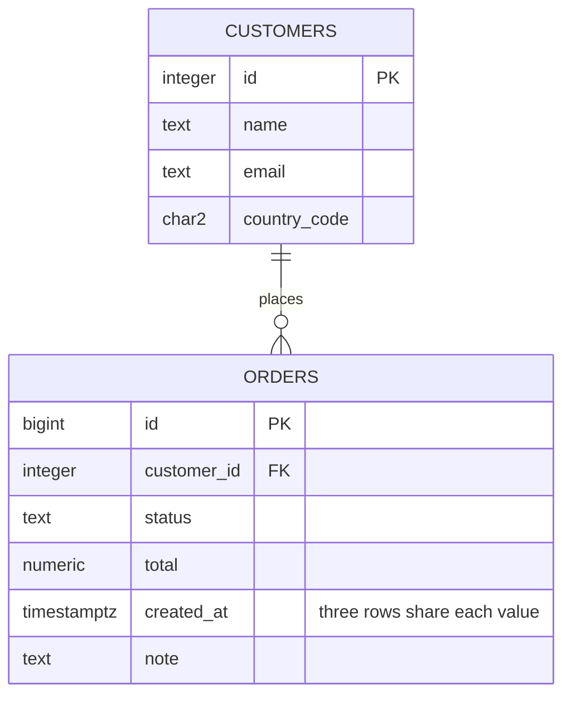
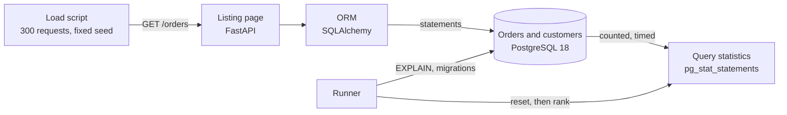

# Markdown and Mermaid

## What it is

**Markdown** is a way of writing formatted documents in plain text. You write `# Title` for a heading, `**bold**`, `- item` for a list, and a program (GitHub, an editor preview) turns it into a nicely formatted page. Every `.md` file in this repository is Markdown. **Mermaid** is a small language for drawing diagrams from text; GitHub and many editors draw a Mermaid block as a picture, so diagrams live in the same file as the words and can be changed with a normal text edit.

## Why this repository uses it

The documentation is part of the product: a README that proves every "Done when" line, an ARCHITECTURE document that names the pattern and draws the data flow, a changelog, a decision record, a results file written by the program, and these notes. All of it is Markdown, so it is read on GitHub and in any editor.

## Where it appears

| File | What it is |
|---|---|
| `README.md` | How to set up, run and test; the proofs of each "Done when" line; the project tree. |
| `ARCHITECTURE.md` | The pattern, the components, the schema (a Mermaid `erDiagram`) and the data flow (a Mermaid `flowchart`). |
| `CHANGELOG.md` | Keep a Changelog format, version 0.1.0. |
| `docs/adr/0001-n-plus-one-lives-in-the-adapter.md` | A decision record. |
| `sql/explain/results.md` | Written by the program: the phase table, the plan table and the rankings. |
| `tech/*.md` | These notes. |

## How it works underneath

**Markdown syntax used here.**

| You write | You get |
|---|---|
| `# Heading`, `## Subheading`, ... | headings of levels 1, 2, ... |
| a blank line | a new paragraph |
| `- item` or `1. item` | a bullet or numbered list |
| `**bold**`, `*italic*` | bold, italic |
| `` `code` `` | inline code in a fixed-width font |
| three backticks, an optional language name, lines, three backticks | a **code block** (``` ```python ```), shown as is, with colours for the named language |
| `[text](https://address)` | a link |
| `\| a \| b \|` rows with a line of `\|---\|---\|` under the first | a table; `:` in the dashes aligns a column (`---:` right) |
| `> text` | a quotation |

Markdown is plain text first: it is readable without any program. Different programs add small extensions (tables and task lists are "GitHub Flavored Markdown"). Two spaces at the end of a line can force a line break, which is why `.editorconfig` does not trim trailing spaces in `.md` files.

**Mermaid.** A code block whose language is `mermaid` holds a diagram description. The first word chooses the diagram type:

- `flowchart LR` (boxes and arrows, left to right). A node is `id["label"]`; `id[("label")]` is drawn as a database cylinder; `a --> b` is an arrow; `a -->|"text"| b` an arrow with a label; `<br/>` is a line break inside a label.
- `erDiagram` (entity-relationship: tables and their columns). `NAME { type column KEY "comment" }` lists a table's columns; `PK` marks a primary key.

The picture is drawn by the viewer; the text stays in the file.

**Documents of other kinds in this repository** are also Markdown: `CHANGELOG.md` follows the Keep a Changelog convention (a section per released version with `Added`, `Changed`, `Fixed` lists); `docs/adr/NNNN-title.md` are **architecture decision records** (a short document per real decision: context, decision, consequences); `tech/` is these notes.

## Walkthrough of this repository's use

### The two Mermaid diagrams

`ARCHITECTURE.md`, lines 39 to 56:

````markdown

````

`erDiagram` starts an entity-relationship diagram. `CUSTOMERS ||--o{ ORDERS : places` draws a relationship: one customer (`||`, exactly one) places zero or more orders (`o{`, zero or many), with the label `places`. Each block (`CUSTOMERS { ... }`) is a table; each line inside is `type column [key] ["comment"]`. `PK` marks a primary key, `FK` a foreign key; the quoted text after `created_at` is shown as a note.

`ARCHITECTURE.md`, lines 62 to 70:

````markdown

````

`flowchart LR` draws left to right. `load["Load script<br/>300 requests, fixed seed"]` is a node with an id (`load`) and a label in quotes, with `<br/>` for a line break. `db[("Orders and customers<br/>PostgreSQL 18")]` draws a cylinder, the symbol for a database. `load -->|"GET /orders"| web` is an arrow labelled with the HTTP request; `orm -->|"statements"| db` labels the SQL traffic. The component names in the boxes (Load script, Listing page, ORM, Orders and customers, Query statistics) are the names of the lesson's own diagram, so the repository and the lesson agree.

### The results file written by the program

`src/busy_listing/application/report.py`, lines 22 to 36:

```python
def render_results(result: LessonResult) -> str:
    """Markdown with the four-phase table, the plan table and the rankings of the first and last phases."""
    out = [
        "# Results of the last `make run`",
        "",
        f"Generated by `busy-listing-run`: {result.requests} requests per phase, page sequence fixed by seed 1 "
        "(pages 0, 1, 2, 50, 100, 5000 and 10000, chosen at random). The plans are the `.txt` files here.",
        "",
        *([result.host_load.note(), ""] if result.host_load else []),
        "## Same load, four phases",
        "",
        "| Phase | Database time ms | Statements | Wall clock s | Median ms: page 1 | page 100 | page 5,000 "
        "| page 10,000 |",
        "|---|---:|---:|---:|---:|---:|---:|---:|",
    ]
```

`render_results` builds Markdown lines in Python: `"# Results of the last `make run`"` is a heading; the line starting `| Phase | Database time ms |` is the table header and `"|---|---:|---:|..."` the separator row in which `---:` right-aligns the numbers. Each data row is an f-string with the same number of `|` separators. In `_table`, a `|` inside a statement is replaced by `/` so it cannot break a table cell.

### The changelog and the decision record

`CHANGELOG.md`, lines 1 to 8:

```markdown
# Changelog

All notable changes to this project are recorded here. The format follows [Keep a Changelog](https://keepachangelog.com/en/1.1.0/) and the project uses [Semantic Versioning](https://semver.org/).

## [0.1.0] - 2026-10-27

### Added

```
`docs/adr/0001-n-plus-one-lives-in-the-adapter.md`, lines 1 to 12:

```markdown
# 0001. The N+1 is an adapter behavior, not a domain concept

Status: accepted, 2026-10-27

## Context

The lesson plants an N+1 on purpose: an ORM loads 20 orders and then one customer per order. A layered design raises the question where that belongs. If the use case knew about "lazy loading", the domain would know about the ORM.

## Decision

The use case (`ListOrders`) and the `OrderRepository` port know three things: a page by number the naive way, a page by number with the customers fetched together, and a page after a cursor. Which of them issues one statement per order is entirely inside `infrastructure/sqlalchemy_orders.py`, where `order.customer.name` triggers the lazy load. The statement count is therefore asserted in an integration test against the real engine, not in a unit test with a fake.

```

The changelog has a heading per version (`## [0.1.0] - 2026-10-27`) and sub-headings `### Added`. The decision record has the fixed parts `Status`, `Context`, `Decision`, `Consequences`.

## Try it yourself

1. Open `ARCHITECTURE.md` on GitHub, or in an editor with a Markdown preview, to see the two diagrams drawn.
2. Paste the flowchart block into https://mermaid.live to edit it and watch the picture change.
3. `grep -c '```mermaid' ARCHITECTURE.md` prints `2`.
4. `head -12 sql/explain/results.md` — the generated tables in raw Markdown; paste them into a previewer to see them as tables.
5. `.venv/bin/python -c "print(open('CHANGELOG.md').read().splitlines()[0])"` prints `# Changelog`.

## Mistakes people make

- Forgetting the blank line before a list or a table, so it is shown as plain text.
- Not closing a code block (three backticks), so the rest of the page turns into code.
- Putting a literal `|` inside a table cell without escaping it.
- Making diagrams so large that nobody can read them.
- Hard-wrapping lines inconsistently, which makes diffs noisy.

**How this repository avoids them.** Every code block is closed; tables have blank lines before them; diagrams are small; `.editorconfig` keeps trailing spaces in `.md` files; generated Markdown comes from one function that is unit-tested (`test_report.py`), including the pipe case.

## Check yourself

1. How do you write a level-2 heading? *Start a line with `## `.*
2. How do you show a command as code? *Put it in backticks for inline code, or in a fenced block with three backticks.*
3. What does a Mermaid block contain? *A diagram described as text, drawn by the viewer.*
4. What does `a -->|"text"| b` draw? *An arrow from node a to node b labelled "text".*
5. What is an ADR? *An architecture decision record: a short document giving the context, the decision and the consequences of one real choice.*

## Further reading

- CommonMark specification (the base of Markdown): https://spec.commonmark.org/ ; GitHub Flavored Markdown: https://github.github.com/gfm/
- Mermaid documentation: https://mermaid.js.org/intro/ (flowchart: https://mermaid.js.org/syntax/flowchart.html ; entity relationship: https://mermaid.js.org/syntax/entityRelationshipDiagram.html)
- Keep a Changelog 1.1.0: https://keepachangelog.com/en/1.1.0/ ; ADRs: https://adr.github.io/
